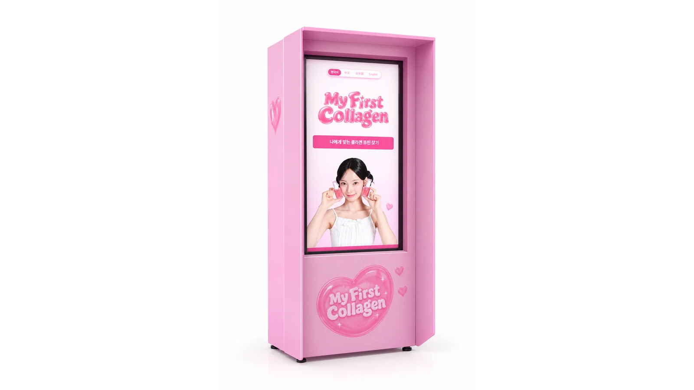
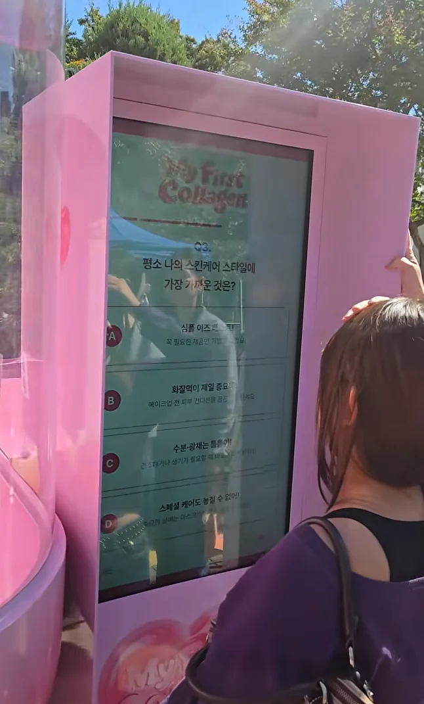

# 현장 설문 키오스크

> 디지털 패스와 같은 팝업 행사장에서, 세로형 터치 모니터로 인터넷 없이 운영한 설문 앱



## 1. 개요

| 항목 | 내용 |
|---|---|
| 기간 | 개발 2026.09.20 ~ 09.27, 운영 2026.09.29 ~ 10.13 (대학 4곳, 4회) |
| 형태 | 행사 대행사를 통한 브랜드 팝업 행사 외주 |
| 참여 | 기획 1명, 개발 1명 |
| 설치 환경 | 행사장 세로형 대형 터치 모니터(Windows), 인터넷 연결 없음 |
| 기술 | Electron 33, electron-vite, React 19, TypeScript, Tailwind CSS 4, Web Audio API, Node.js 파일 시스템, exceljs |
| 링크 | [데모](https://subdevpi.mywire.org:9000/kiosk/), [상세 설명](https://subdevpi.mywire.org/portfolio/바이오던스-팝업-설문-키오스크) |

같은 행사의 사전 설문과 QR 입장은 [디지털 패스](https://subdevpi.mywire.org/portfolio/바이오던스-팝업-디지털-패스)에서 따로 만들었습니다.

## 2. 화면

| 행사장 설치 모습 |
|---|
|  |
| 세로형 터치 모니터에서 설문 진행 |

## 3. 주요 기능

- 메인 → 설문 5문항 → 추천 로딩 → 결과 화면 순서로 진행하고, 답변에 맞는 스킨케어 루틴 추천
- 한국어, 중국어, 일본어, 영어 지원. 처음 화면으로 돌아가면 한국어로 초기화
- 참여 기록을 기기 안의 파일에 바로 저장 (개인정보는 받지 않음)
- 비밀번호로 여는 설정 화면에서 날짜별 참여자 수 확인, Excel 내보내기, 효과음 음량 조절
- 전체화면 키오스크 모드, 화면 꺼짐 방지, 앱 중복 실행 방지

## 4. 구성

```
src/
├── main/            Electron 메인 프로세스
│   ├── window.ts    키오스크 창, 화면 꺼짐 방지
│   ├── store/       참여 기록 저장, 로그
│   ├── excel/       Excel 내보내기
│   └── metrics.ts   5분마다 메모리 기록
├── preload/         화면과 메인 프로세스 연결
└── renderer/        React 화면 (설문, 결과, 설정)
```

참여 기록과 로그는 다음 위치에 남습니다.

```
%APPDATA%\EventKiosk\
  data\YYYY-MM-DD.jsonl   날짜별 참여 기록
  logs\YYYY-MM-DD.log     오류, 메모리 로그
```

## 5. 기술 선택

| 기술 | 고른 이유 |
|---|---|
| Electron | 인터넷 없이 하루 종일 켜두고, 기록을 기기 안 파일로 남기고, 방문객이 앱을 끄거나 화면이 꺼지지 않게 막아야 해서 웹 페이지 대신 설치형 앱으로 만들었습니다. 화면은 디지털 패스처럼 React로 만들 수 있었습니다. |
| JSONL 파일 | 참여 한 건을 파일 끝에 한 줄씩 붙이기만 하면 돼서, 저장 중 전원이 꺼져도 앞선 기록은 그대로 남습니다. JSON 배열 하나로 저장하면 매번 파일 전체를 다시 써야 합니다. |
| Web Audio API | `<audio>` 태그로 효과음을 틀면 누를 때마다 살짝 늦게 나서, 앱을 켤 때 효과음을 미리 불러와 두고 바로 재생했습니다. |

## 6. 구현하며 고려한 점

### 6-1. 참여 기록을 잃지 않는 저장 방식

- 날짜별 JSONL 파일에 한 줄씩 덧붙이고 매번 `fsync`로 디스크에 기록했습니다.
- 참여번호 파일은 임시 파일에 쓴 다음 이름을 바꿔 교체해서, 쓰는 도중 꺼져도 반쯤 쓰인 파일이 남지 않게 했습니다.
- 저장에 실패하면 두 번 더 시도하고, 그래도 안 되면 `localStorage`에 임시로 보관했다가 다음 실행 때 저장합니다. 설정 화면에 저장 대기 건수가 보입니다.

### 6-2. 터치 모니터에서 버튼이 잘 안 눌리는 문제

대형 터치 모니터에서는 누르는 동안 손가락이 조금만 밀려도 브라우저가 스크롤로 판단해 클릭을 취소했고, 길게 누르면 Windows가 우클릭으로 처리했습니다. 그래서 `onClick` 대신 **손을 뗀 위치가 버튼 위면 누른 것으로 판단**하는 공통 처리(`press.ts`)를 만들어 모든 버튼에 적용했습니다.

### 6-3. 운영 중 화면이 느려지는 문제

| 단계 | 내용 |
|---|---|
| 증상 | 참여가 200건 넘게 쌓이면 화면이 느려지고 버튼이 가끔 반응하지 않았습니다. |
| 확인 | 행사 도중이었기에 빠른 조치가 필요했고, 코드를 고치기 전에 Claude Code로 원인 후보를 정리했습니다. 그중 결과 화면의 컨페티 캔버스를 떼어 낸 테스트 앱을 만들어 직접 재현했습니다. |
| 원인 | 결과 화면마다 화면 크기만 한 캔버스를 새로 만들고 버리는 구조였습니다. 결과 화면을 벗어나 메인으로 돌아온 뒤에도 GPU 프로세스 메모리가 804MB로 남아 있었고, 캔버스를 재사용하도록 고친 뒤에는 489MB였습니다. 캔버스를 만들고 버릴 때마다 GPU 메모리가 바로 정리되지 않고 할당과 해제가 반복되면서 화면이 끊긴 것으로 판단했습니다. |
| 해결 | 캔버스를 하나만 만들어 계속 쓰고, 해상도를 기준 화면 크기로 고정했습니다. |

수정 전후 빌드를 세로 전체화면(1080x1920)에서 처음부터 결과 화면까지 자동 입력으로 60번씩 반복해 비교했습니다. 측정 스크립트와 원자료는 [`docs/memory-benchmark`](docs/memory-benchmark)에 있습니다.

| 앱 전체 프로세스 메모리 (결과 화면 표시 중 최대) | 수정 전 | 수정 후 | 변화 |
|---|---:|---:|---:|
| 메인, GPU, 렌더러 등 모든 프로세스 합계 | 1,067MB | 811MB | 약 24% 감소 |

줄어든 양은 대부분 GPU 프로세스에서 나왔고, 창 모드(704x1241)에서는 수정 전후 차이가 없었습니다. 혹시 다른 곳에서 메모리가 쌓일 경우에 대비해 메모리 상태를 5분마다 기록하고, 참여 50건마다 메인 화면에서 아무도 만지지 않을 때 화면을 새로 불러오게 했습니다.

## 7. 결과

- 패치 후 같은 증상 없이 행사를 마쳤고, 4회 동안 설문 약 1,100건이 저장됐습니다.

## 8. 실행 방법

```bash
npm install
npm run dev    # 개발 모드 (일반 창)
npm run dist   # Windows 설치 파일 생성 → release/
```

설치된 앱은 전체화면 키오스크 모드로 실행됩니다.

## 9. 회고

컨페티 캔버스 문제는 몇 번 눌러보는 테스트로는 보이지 않았고 현장에서 처음 드러났습니다. 짐작으로 고치지 않고 수정 전후를 같은 조건으로 재 본 덕분에 수정이 맞았는지 숫자로 확인할 수 있었습니다. 터치 누름 문제도 마우스로 개발할 때는 몰랐던 부분이라, 실제 설치될 기기에서 직접 눌러보는 과정이 꼭 필요하다는 걸 알게 됐습니다.
